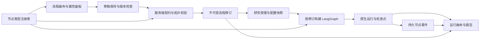
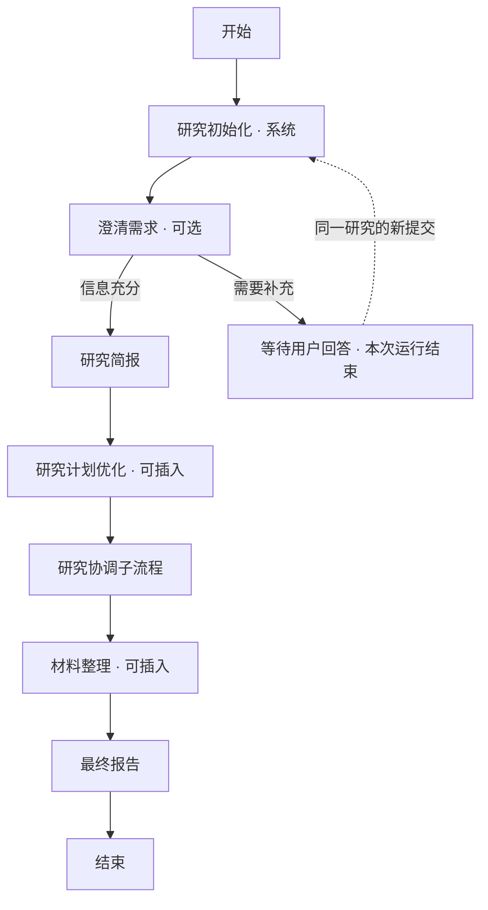

# Graph 可视化流程编辑器项目计划书

编制日期：2026-11-14；项目：Deep Research · 星图工作台。

调研基线：当前工作区，Git 提交 `d8caa38`。

文档状态：M0–M3 已完成，前端设计稿已获用户确认；正式编辑、不可变发布、生产编译、原子受理绑定及运行事件已接入。下一阶段为 M4 有界真实质量与性能验收。实际证据见 [M3 记录](graph-canvas-editor-m3-results.md)及 [v1 契约](graph-canvas-editor-contract.md)，早期阶段记录继续保留。

实施起点、M0 验证重点和后续进度维护见 [实施交接](graph-canvas-editor-handoff.md)。

推进顺序更新（2026-11-15）：用户已确认设计稿，要求执行 M2 并继续 M3。M3 的实际生产上下文和节点已通过替身及原生验收，已发布版本可用于新研究。M4 的真实调用、质量与性能测量尚未开展，具体范围见实施交接。

## 1. 项目目标与建议

将当前的运行图谱升级为可编辑、可保存、可发布、可执行的研究流程画布。用户可以添加、删除、移动节点，调整合法连接和节点参数，发布一个流程版本，再使用该版本开展真实研究。

**已确认的需求：编辑结果需要影响后端实际执行。** 因此，本项目的交付包含前端编辑器、流程定义与版本管理、后端校验与编译、执行接入、运行观察和兼容性验证。

建议采用“主流程编辑先行，复杂编排逐步开放”的路线：首版开放研究主流程及两类可插入的处理节点；研究协调器内部的并行任务继续由现有子图负责。条件分支、任意循环、研究员内部流程编辑列入后续版本。

首版完成后，用户应能独立完成以下闭环：

1. 从内置研究流程创建草稿。
2. 在研究简报之后添加“研究计划优化”节点，设置处理要求；或删除可选节点。
3. 保存草稿，查看并修复连接及配置问题。
4. 发布不可变的流程版本。
5. 选择该版本发起新研究，观察实际经过的节点及输出。
6. 修改并发布新版本后，既有研究继续使用原版本，历史结果仍可回读。

预计首版需要 **44–58 个开发人日，另加 8–12 个测试人日**。按一名前端、一名后端和兼职测试配置，建议安排 **6–8 周**；具体排期在第一阶段的运行时验证后校准。

## 2. 立项基线与改造依据

本节保留立项时的改造依据；当前 M3 实现状态以阶段表、实施交接和 M3 验证记录为准。

| 现有模块 | 已核对的行为 | 对本项目的影响 |
| --- | --- | --- |
| [Graph.tsx](../frontend/src/components/Graph.tsx) | 使用 DOM 布局、SVG 曲线和固定节点顺序绘图；支持查看详情、定位当前步骤、刷新状态 | 需要引入正式的画布交互层和独立流程定义 |
| [live.ts](../frontend/src/data/live.ts) | 固定生成澄清、简报、协调器、报告四类主节点，根据阶段推导状态 | 新流程必须按实际版本和节点执行记录渲染，不能继续按数组顺序推断完成状态 |
| [researchEvents.ts](../frontend/src/data/researchEvents.ts) | 根据实际委派事件生成研究员卡片 | 研究员卡片属于运行实例，需要与设计时节点区分 |
| [Inspector.tsx](../frontend/src/components/Inspector.tsx) | 展示节点概览、输入输出、事件 | 可以复用展示组件，另建节点配置表单 |
| [research_agent_full.py](../src/deep_research/research_agent_full.py) | 固定注册五个父节点；部分流转通过节点返回的 `Command(goto=...)` 决定 | 编辑连线需要同步改造路由，不能只修改 `add_edge` |
| [multi_agent_supervisor.py](../src/deep_research/multi_agent_supervisor.py) | 协调器在执行时委派研究员，包含并行调用和继续研究循环 | 首版封装为一个可观察的研究子流程节点 |
| [submission_api.py](../src/deep_research/submission_api.py) | 受理、重试、恢复具有持久身份；创建执行时固定使用 `research_agent_full` | 需要将已发布流程版本接入受理和调度 |
| [run_configuration.py](../src/deep_research/run_configuration.py) | 模型与 Skills 按研究保存不可变配置快照 | 流程版本需要与这些快照一起绑定并校验 |
| [frontend/package.json](../frontend/package.json) | React、TypeScript、Vite、Zod、Playwright；尚无流程编辑库 | 可以在现有技术栈内扩展 |

当前完整主图为：开始 → `prepare_research` → 澄清需求 → 研究简报 → 研究协调子图 → 最终报告 → 结束。`prepare_research` 负责身份、状态重置等生命周期工作，当前展示图没有单独显示它。

澄清需要补充信息时，本次 run 结束并等待回答；回答通过同一个 thread 的新 run 继续同一轮研究。当前协议并非 `interrupt/resume`。

现有恢复仅验证了澄清、简报、报告写作三个父节点边界。研究子图执行中断后的任意位置恢复尚不受支持。以上约束以 [架构约定](architecture-decisions.md)、[维护说明](maintenance.md) 和 [后端接口约定](../frontend/docs/backend-contract.md) 为依据。

## 3. 功能范围

### 3.1 首版：可编辑并执行的研究工作流

| 模块 | 首版功能 | 主要验收点 |
| --- | --- | --- |
| 流程管理 | 内置模板、创建草稿、重命名、复制、归档 | 可以管理多个独立流程 |
| 画布操作 | 拖拽、平移、缩放、适应画布、框选、自动布局 | 节点和连线位置随草稿保存 |
| 节点编辑 | 从节点库添加、删除可选节点、复制扩展节点、编辑名称和参数 | 编辑会改变发布版本的执行定义 |
| 连线编辑 | 创建、删除、重新连接；提示端口与阶段不兼容 | 断连草稿可保存，非法流程不能发布 |
| 操作历史 | 撤销、重做；一次拖拽或批量删除作为一个操作 | 可以完整撤销节点及其关联连线变化 |
| 草稿保存 | 自动保存、手动保存、保存失败提示、编辑冲突检测 | 刷新恢复已保存内容；旧标签页不能覆盖新内容 |
| 节点配置 | 展示输入输出约束；编辑扩展节点提示要求；配置流程默认模型角色与 Skills 选择 | 配置范围与服务端目录、节点能力一致 |
| 校验与发布 | 问题清单、定位问题节点、发布版本、查看版本、从旧版复制草稿 | 发布时服务端重新验证确切草稿版本 |
| 实际执行 | 从已发布版本发起研究；记录流程修订、节点状态和结果 | 添加或删除节点后，真实执行路径相应改变 |
| 运行观察 | 当前节点、输入输出、失败信息、动态研究员展开、历史版本查看 | 新旧运行、不同版本的数据不会混用 |
| 导入导出 | 带 schema 版本的 JSON 导出、校验后导入为新草稿 | 不包含密钥、运行数据及机器本地路径 |

首版模型选择继续使用现有六个角色。节点显示其使用的角色及实际模型；同角色的多个节点沿用同一研究的角色配置。单个节点实例独立选择模型属于后续扩展，需要单独扩展配置快照协议。

### 3.2 首版节点库与删除规则

| 节点 | 是否允许添加或删除 | 首版配置与执行边界 |
| --- | --- | --- |
| 开始、研究初始化、结束 | 系统节点，锁定 | 维护研究身份、状态清理和生命周期 |
| 澄清需求 | 可移除，也可重新添加；最多一个 | 移除后直接生成简报，仍保留原始用户要求的解析 |
| 研究简报 | 必需且唯一，锁定 | 生成研究简报及协调器所需消息 |
| 研究协调子流程 | 必需且唯一，锁定 | 复用现有协调器、研究员、工具、Skills 和证据归集 |
| 最终报告 | 必需且唯一，锁定 | 保留现有报告流式、核验、来源约束和结果归属 |
| 研究计划优化 | 可添加、复制、删除 | 放在简报与研究子流程之间；使用 SCOPING 角色 |
| 材料整理 | 可添加、复制、删除 | 放在研究子流程与报告之间；使用 COMPRESSION 角色 |

首版的“自由编辑”作用于满足研究输入输出约束的主流程。必需节点的等价替换可以在节点契约稳定后开放。这样能够先交付真实的新增与删除能力，并保持最终产物仍为研究报告。

研究协调器内显示的“研究员 01、02……”属于本次运行的任务实例：运行时可查看，设计时不能通过删除卡片取消任务。固定研究员分支及其内部工具编排属于后续版本。

删除可选节点时，一并移除关联连线，并支持整步撤销；若只有一个前驱、一个后继且端口兼容，可提供“连接前后节点”操作。系统不猜测多分支的连接意图。核心节点以锁定样式说明所需产物。

### 3.3 后续版本

| 版本 | 建议扩展 | 开放前提 |
| --- | --- | --- |
| V1.1 | 更丰富的节点模板、版本差异展示、节点独立模型配置 | 输入输出契约、配置快照及成本统计稳定 |
| V2 | 条件分支、指定的并行分支与汇合、可配置循环、子流程编辑 | 具备分支完备性、reducer、循环上限和恢复测试 |
| V3 | 自定义工具接入、团队共享、权限与多人协作 | 完成部署、身份、存储及操作隔离方案 |

首版面向当前单用户、本地单进程服务。任意 Python/JavaScript 执行、任意网络工具、运行中的结构热修改和多人实时协作不纳入本次估算。

## 4. 用户界面与操作流程

以下内容作为前端设计稿的功能依据。先结合现有工作台制作可查看的页面及关键交互状态，经用户确认后再实施；M0 技术画布不视为已确认的界面设计。

### 4.1 界面组织

新增独立的“流程管理”入口和大画布编辑视图，沿用工作台现有银白／石墨主题。

| 区域 | 内容 |
| --- | --- |
| 顶部 | 流程名称、草稿或版本标识、保存状态、撤销／重做、校验、发布、使用此版本发起研究 |
| 左侧 | 节点库，按基础流程、研究处理、辅助说明分类 |
| 中间 | 可拖拽节点、连线、背景网格、缩放与自动布局操作 |
| 右侧 | 所选节点的名称、作用、可编辑参数、输入输出要求 |
| 底部 | 校验结果；点击问题定位到对应节点、连接或字段 |

原运行图谱继续承担执行观察职责。从运行图进入“编辑此流程”时，打开该运行绑定版本的草稿副本；运行视图展示原版本及其执行状态。旧记录没有完整版本存档时，只能从明确标注的内置模板新建草稿。

桌面端优先提供完整编辑能力。窄屏支持查看、缩放和检查节点，首版不承诺完整触屏编排体验。节点操作提供键盘入口，表单输入时 Delete、撤销等快捷键作用于输入内容，中文输入法组合期间不触发画布命令。

### 4.2 保存、发布与执行

1. 用户编辑草稿；界面显示“未保存／保存中／已保存／保存失败”。
2. 自动保存使用编辑版本号；检测到冲突时保留本地内容，提示重新加载或另存副本。
3. 点击“校验”只检查流程，不调用模型或搜索。
4. 点击“发布”提交确切的草稿版本号；服务端重新校验、生成不可变修订并返回版本标识。
5. 点击“使用此版本发起研究”，进入新研究会话，输入研究问题后才创建实际执行。
6. 后续改动保存在新草稿中，再次发布生成另一修订。

归档流程后，从新建流程选择列表隐藏它；已被研究引用的版本继续保留。恢复旧方案通过“从该版本创建草稿并重新发布”完成，不改写过去的发布记录。

## 5. 技术架构

### 5.1 总体设计



编辑画布和运行画布共享节点及连线视觉组件，但分别使用流程定义和运行状态。流程定义描述“应该如何执行”；事件与检查点描述“实际发生了什么”。拖拽坐标、选中状态、执行状态不得混入后端业务节点参数。

### 5.2 技术选型

| 层次 | 建议方案 | 选择理由 |
| --- | --- | --- |
| 画布 | `@xyflow/react@12.12.1`（React Flow） | M0 已验证与当前 React／TypeScript／Vite 兼容，提供基础画布交互 |
| 自动布局 | `@dagrejs/dagre@3.1.3` | M0 已验证分层布局；复杂嵌套布局后续再评估 ELK |
| 前端状态 | 独立 `useWorkflowEditor` 与 reducer | 复用当前 React 组织方式，隔离编辑草稿与研究运行状态 |
| 前端校验 | Zod + 节点注册表提供的参数描述 | 及时反馈字段错误；发布结论由服务端决定 |
| 后端契约 | Pydantic + 显式节点注册表 | 校验节点类型、参数、端口及版本兼容性 |
| 后端接口 | 扩展现有 Starlette HTTP app | 复用 `/atlas` 能力发现和本地服务 |
| 持久化 | SQLite，版本化增量迁移 | 适配现有本地部署与受理存储体系 |
| 执行 | LangGraph 原生图工厂与检查点 | 保留现有运行、流式、受理和恢复基础 |
| 验证 | pytest + Playwright + 原生服务替身 | 覆盖图逻辑、浏览器操作及进程故障边界 |

新增依赖已在 M0 锁定，类型检查、生产构建、独立原型构建和三项浏览器验证通过，见 [验证记录](graph-canvas-editor-m0-results.md)。首版按需加载编辑器资源，减少对日常研究页面首屏的影响；当前原型使用独立页面入口。

### 5.3 数据模型

建议定义以下独立对象，避免直接将 React Flow 内部对象作为长期存储协议：

| 对象 | 关键内容 |
| --- | --- |
| `WorkflowDefinition` | schema 版本、流程身份、节点、连接、执行设置 |
| `NodeDefinition` | 稳定实例 ID、节点类型、类型版本、参数 |
| `EdgeDefinition` | 稳定连接 ID、起终节点及端口 |
| `WorkflowPresentation` | 节点名称、坐标、视口和说明等展示信息 |
| `WorkflowDraft` | 定义、展示信息、基础发布版本、编辑版本号、更新时间 |
| `WorkflowRevision` | 不可变定义与展示快照、内容哈希、编译器／节点注册表／状态 schema 版本 |
| `WorkflowBinding` | 原生 thread、流程修订与执行图 ID 的绑定 |
| `WorkflowRunState` | 研究及 run 身份、流程修订、当前节点、各节点执行状态与结果引用 |

节点实例 ID 创建后保持稳定，修改名称或位置不改变执行身份。首版核心节点保留与现有父节点对应的稳定运行名称；扩展节点使用独立实例 ID，并保存画布节点与原生节点的映射。

语义哈希覆盖执行相关字段，不包含坐标、选中状态等界面信息。发布快照仍包含当时的展示信息，保证历史图可以按原布局回看。导入会重新建立流程身份，不覆盖原流程或继承其发布权限。

### 5.4 存储与并发

建议通过独立 `workflow_store.py` 管理流程表，首版将流程修订、thread 绑定及受理引用放入现有受理 SQLite 的同一数据库文件。由同一事务持久化受理意图、使用的流程修订和配置快照，避免“记录已受理，但版本绑定丢失”。

建议新增 `workflow_definitions`、`workflow_drafts`、`workflow_revisions`、`workflow_thread_bindings` 和受理关联表。具体表名可在实现时调整，必须维持以下语义：

- 草稿更新带 `expected_edit_version`，过时写入返回冲突。
- 发布带幂等请求 ID 与预期编辑版本；重复请求返回同一发布结果。
- 发布修订只能追加；删除或归档不移除被运行引用的数据。
- 校验和图构建在短事务之外完成；提交时再次核对版本，避免长时间占用数据库写锁。
- 数据迁移保留旧受理 payload、摘要和历史配置；发布前制作包含原生检查点、受理库、配置归档及事件库的一致备份。

## 6. 流程语义、编译与实际执行

### 6.1 首版允许的拓扑



图中的两个扩展节点可以缺省；缺省时连接对应的前后节点。删除澄清后，初始化直接连接简报。等待补充、失败终止及研究子图内部循环属于系统控制行为，首版不开放编辑。

连线首先表达控制流及允许通过的上下文阶段，底层仍使用共享的 `AgentState`。首版不引入自由变量映射语言。

“研究计划优化”必须同步更新简报和供协调器读取的消息，避免画布显示优化成功、协调器却仍使用旧简报。“材料整理”只能消费已有有效笔记；原始笔记、来源与证据定位保留，整理结果不能被注册为新的检索来源。替换带 reducer 的笔记或消息集合时，必须显式处理 `Overwrite`，防止意外追加和重复消费。

### 6.2 发布校验

| 校验层 | 检查内容 | 失败处理 |
| --- | --- | --- |
| 结构 | schema／类型版本、ID 唯一、连接引用存在、字段及大小限制 | 指明节点、连接或字段路径 |
| 拓扑 | 唯一入口与出口、无孤岛、所有正常路径可完成、核心节点数量 | 阻止发布并定位问题 |
| 阶段 | 简报、研究、笔记、报告的前后关系；端口相容性 | 拒绝跨阶段错误连接 |
| 路由 | 首版无用户自定义环、无任意多分支、正常出口唯一 | 避免重复调度与不可达节点 |
| 状态 | 节点读写字段、所需输入、集合合并方式、保留字段保护 | 拒绝不满足状态契约的组合 |
| 配置 | 模型／Skills 修订可解析、参数在服务端上限内、提示变量来自允许集合 | 显示可修复的配置问题 |
| 运行兼容 | 编译器、节点注册表、状态 schema 和当前运行时兼容 | 不生成可执行发布版本 |

建议首版限制每个可执行流程最多 30 个主流程节点；单节点输入大小、超时及模型尝试次数沿用或收紧服务端上限。画布展示规模与执行规模分别测试。用户设置不能突破服务端上限。

校验返回统一问题结构，例如 `code`、`severity`、`node_id`、`edge_id`、`field`、`message`。前端用于展示和定位，服务端始终完整复验。

### 6.3 节点注册与路由改造

服务端为每个节点类型登记参数 schema、输入输出要求、可写状态字段、对应函数、版本、可使用的模型角色及恢复能力。浏览器只接收可公开的节点描述，不接收函数路径、网关或凭据。

现有父节点中存在硬编码的 `Command(goto=...)`。实施时应将业务更新与下一步选择分离：业务执行返回状态更新和明确结果，如继续、等待补充、失败；编译层根据已发布连线决定正常后继，系统结果进入对应终态。

必须保证同一结果只有一种调度机制。保留旧 `Command.goto` 的同时再增加普通边，可能造成旧后继和新后继同时执行，需要通过确定性执行计数测试排除。

保留旧导出图及独立评估入口，通过适配器复用已有业务逻辑。模型初始化前加载环境配置；新增结构化处理继续使用共享 `structured_output_fallback.py`，保留 Qwen `/no_think`、空 `choices` 处理和诊断。

### 6.4 原生执行接入

建议在 `langgraph.json` 增加稳定入口 `research_workflow`，由图工厂根据服务端已受理的流程修订构建图。无需为每个发布版本修改注册文件或重启服务；新增节点实现或升级代码仍属于正常后端部署。

M0 在 LangGraph 1.1.3、API 0.8.7、inmem runtime 0.28.1 验证了隔离工厂路径。M3 已在相同版本接入独立生产工厂、原子受理绑定、新摘要兼容及受理前执行校验，并通过正式编辑器发布两个版本的原生浏览器验收。生产不使用 M0 测试重定向。

图工厂应只从服务端归档读取已发布定义，按语义哈希及编译器／节点注册表版本缓存可复用的图结构。运行上下文和检查点由原生运行时注入，不将其他研究的可变状态存入缓存。

第一版建议固定一个原生 thread 使用一个执行图和流程修订。切换流程或版本时，通过“使用此版本发起新研究”创建新会话；同会话中的澄清继续沿用原绑定。现有模型与 Skills 仍按逻辑研究锁定，不改变其语义。

这一边界让历史检查点读取和恢复可以确定图结构。将来若允许同一个原生 thread 切换结构，需要单独验证历史检查点路由及状态迁移，不能仅替换一个 revision 字段。

### 6.5 版本绑定、事件与恢复

新研究的受理记录应固定流程 ID、修订 ID、语义哈希、执行图 ID、编译器和节点注册表版本，同时保存原有模型／Skills 快照。提交、重试、澄清及恢复校验同一份绑定；恢复使用 `input: null` 时，也必须能找回原版本。

新增父流程节点事件建议使用独立的 `atlas.workflow_event` 命名空间与版本，保留现有研究员事件和报告正文事件的语义。事件至少携带研究、turn、run、attempt、流程修订、节点实例、事件 UUID 和连续序号。复用持久日志与回放模式，为扩展节点提供准确的开始、结束、失败和输出摘要。

业务阶段仍可显示“生成简报／研究／写作”等聚合状态；具体节点完成情况来自实际节点记录。事件落盘后再发布，刷新和断线重连只读取已有执行。成功结论仍依据终态检查点、`research_status`、报告归属和有效产物，不能用连线动画或 SSE 结束替代。

恢复策略延续既有三个父节点边界，并增加流程版本与节点输入的校验。新增字段仅在存在时参与新摘要，避免改写旧检查点的摘要语义。扩展节点及研究子图内部节点默认不声明可恢复；只有完成对应故障测试后才逐项开放。中断时保留已确认成果，并明确提供新建研究入口。

版本归档不能替代代码兼容性：仅保存 JSON 和版本号，无法自动恢复已经删除的旧节点实现。服务端需要保留可支持的执行版本，或将对应历史研究标记为“可查看、当前不可续跑”，不能偷偷改用新实现。

## 7. 接口与代码改动建议

### 7.1 拟新增接口

以下管理接口已在 M2 实现，M3 已接入运行事件接口。精确请求、响应、摘要补充接口及分页见 [v1 契约](graph-canvas-editor-contract.md)：

| 方法与路径 | 用途 |
| --- | --- |
| `GET /atlas/workflow-node-types` | 读取节点目录、参数描述、连接约束 |
| `GET /atlas/workflows` | 查询流程及草稿／发布摘要 |
| `POST /atlas/workflows` | 从模板、导入内容或旧版本创建新流程 |
| `GET /atlas/workflows/{id}` | 读取流程和当前草稿 |
| `PUT /atlas/workflows/{id}/draft` | 按预期编辑版本保存草稿 |
| `POST /atlas/workflows/{id}/validate` | 校验确切草稿版本 |
| `POST /atlas/workflows/{id}/publish` | 幂等发布确切草稿版本 |
| `GET /atlas/workflows/{id}/revisions` | 读取已发布版本列表 |
| `GET /atlas/workflows/{id}/revisions/{revision_id}` | 读取不可变版本与展示快照 |
| `POST /atlas/workflows/{id}/archive` | 归档流程，保留运行引用 |
| `GET /atlas/threads/{thread_id}/runs/{run_id}/workflow-events` | 分页读取父流程节点事件 |

研究启动继续扩展现有 submissions 接口。客户端新增的选择字段只包含版本引用，例如：

```json
{
  "workflow_ref": {
    "workflow_id": "workflow-identifier",
    "revision_id": "published-revision-identifier"
  }
}
```

这是对现有提交体的字段补充示意，不是完整提交请求。其余内容摘要、原生 run 身份、实际执行图和配置均由受理层解析并固定。

`GET /atlas/config` 建议分别声明 `workflow_editor_version`、`workflow_execution_version`、`workflow_events_version` 等可选能力。草稿功能可先开放，实际执行能力须在原生验收通过后声明。现有 `graph_id` 和旧客户端含义保持兼容，新增工作流执行入口单独描述。

旧请求省略 `workflow_ref` 时保留原语义和 payload 摘要；新增字段存在时参与幂等比较。旧后端不支持执行能力时，前端不能把用户选择的流程静默改成内置流程执行。

### 7.2 建议文件分工

| 文件或模块 | 工作内容 |
| --- | --- |
| `frontend/src/components/workflow/` | 编辑页面、共享画布、节点库、属性表单、校验列表、版本面板 |
| `frontend/src/state/useWorkflowEditor.ts` | 草稿状态、操作历史、保存及冲突处理 |
| `frontend/src/data/workflowSchema.ts` | 定义、修订、节点目录及运行事件 schema |
| `frontend/src/api/workflows.ts` | 流程管理、发布及回放接口 |
| `frontend/src/components/Graph.tsx` | 新流程运行视图接入；保留旧运行／演示适配 |
| `frontend/src/App.tsx`、`Sidebar.tsx` | 流程管理入口与页面切换 |
| `frontend/src/data/liveSchema.ts`、`live.ts` | 可选流程快照、节点状态及历史兼容 |
| `frontend/src/state/useLiveResearch.ts`、`api/submissions.ts` | 选择版本、锁定提交、恢复归属校验 |
| `src/deep_research/workflow_definition.py` | 数据契约和版本定义 |
| `src/deep_research/workflow_registry.py`、`workflow_nodes.py` | 类型注册、业务适配器及两个扩展节点 |
| `src/deep_research/workflow_validation.py`、`workflow_compiler.py` | 校验、路由、图工厂及编译缓存 |
| `src/deep_research/workflow_store.py`、`workflow_api.py`、`workflow_events.py` | 草稿／修订、管理接口、父节点事件 |
| `src/deep_research/research_agent_full.py`、`state_scope.py` | 拆分硬编码路由，扩展可选执行状态 |
| `src/deep_research/submission_api.py`、`submission_journal.py` | 流程绑定、幂等事务和恢复校验 |
| `src/deep_research/atlas_api.py`、`model_config.py`、`langgraph.json` | 路由、能力声明与新执行入口 |
| `tests/`、`frontend/tests/` | 编译与版本测试、编辑器端到端测试、原生故障测试 |

现有 `NodeDetail` 保留展示模型职责，增加适配层连接新定义和真实执行数据；不将所有画布操作塞进现有 `useWorkspace` 的研究状态。

## 8. 实施阶段、人员与交付物

| 阶段 | 重点工作 | 交付与通过条件 | 开发人日估算 |
| --- | --- | --- | --- |
| M0：技术验证（已完成） | 图工厂、两个不同修订、原生状态读取、重启恢复、前端依赖兼容 | 20 项后端验证、3 项画布验证通过；[证据及边界](graph-canvas-editor-m0-results.md) | 4–6 |
| M1：契约与交互设计（已完成） | 定稿确认、节点目录、允许拓扑、定义 schema、保存／发布协议 | 设计稿获用户确认，v1 核心契约与验收条件冻结；后端及回归 124 项、前端契约 60 项通过 | 6–8 |
| M2：编辑与版本管理（已完成） | 画布、参数表单、撤销、保存、冲突、导入导出、发布归档 | 后端及回归 174 项、前端 164 项通过；发布事务与界面用测试上下文验证，生产发布待 M3 实际编译器 | 12–16 |
| M3：编译与运行接入（已完成） | 业务适配、两个扩展节点、原子版本受理、父事件、正式运行图 | 后端 226、原生 API 14、前端 230、原生浏览器 1 项通过；见 [M3 记录](graph-canvas-editor-m3-results.md) | 14–18 |
| M4：稳定性与交付 | 故障注入、旧数据／演示兼容、性能、主题与键盘验证、文档 | 关键场景全部通过，形成可复现验收记录 | 8–10 |
| 合计 |  |  | **44–58** |

建议配置一名前端、一名后端，测试人员在 M1 参与用例设计，在 M3–M4 集中联调；产品或使用者每周评审一次可运行增量。接口冻结后，前端编辑和后端编译可以并行开发。

两名开发人员的日历排期建议为 6–8 周，包含依赖衔接、联调和约 15% 的机动时间；单名全栈开发建议按 10–13 周安排。以上不包含 V2/V3、生产多用户部署、供应商不可用导致的等待或大规模模型质量优化。

M0–M3 已通过对应阶段验收，当前进入 M4。排期数值仍是最初的人日估算，不是本轮实测工时；真实模型质量、调用费用及性能测量仍按后续阶段推进。

预算可按“开发人日 × 团队日费率 + 测试人日 × 日费率 + 有界模型／搜索验收费用”计算。当前未提供团队费率和验收模型，因此不填估算金额；未知调用费用保留为未知。

## 9. 验收标准与验证方式

### 9.1 必须通过的业务场景

| 场景 | 可核对的结果 |
| --- | --- |
| 内置模板运行 | 无扩展节点时，澄清、研究、报告及失败处理与现有契约一致 |
| 新增节点生效 | 插入“研究计划优化”后，调用计数增加对应节点，协调器实际接收优化后的简报 |
| 删除节点生效 | 删除该扩展节点并发布新修订，新研究不再调用它；原修订回放及恢复仍按原定义 |
| 删除澄清 | 新研究跳过澄清模型调用，仍保留原始要求并正常生成简报 |
| 非法连接 | 悬空连接、跨阶段连接、缺少必需产物、额外出口、自环或未知类型均无法发布 |
| 草稿持久化 | 刷新保留已保存定义及布局；保存失败保留本地改动；双标签页冲突不静默覆盖 |
| 发布幂等 | 发布响应丢失后使用原请求 ID 重试，不产生两个发布版本 |
| 受理幂等 | 执行请求响应丢失后回读或重试，实际 run 数量符合原受理身份 |
| 配置隔离 | 不同会话选择不同修订、模型和 Skills，检查点及实际调用互不混用 |
| 澄清与发布并发 | v1 等待回答期间发布 v2，v1 的澄清继续及后续节点仍使用 v1 |
| 服务重启 | 已发布版本和绑定可回读；安全边界用原版本恢复；不安全位置不自动续跑 |
| 证据与结果 | 材料整理不制造新来源；无有效笔记不生成成功报告；部分失败保留有效成果 |
| 历史兼容 | 旧缓存、旧受理、旧检查点和真实记录演示可打开；不补写虚构流程修订 |
| 执行版本缺失 | 旧定义或节点实现不再兼容时明确拒绝续跑，不换用最新流程 |

### 9.2 验证分层

1. **确定性后端测试**：拓扑、节点契约、路由唯一性、状态合并、修订不可变、摘要兼容、实际调用顺序和计数。
2. **浏览器替身测试**：添加／删除／连接／撤销、保存冲突、发布失败、版本选择、运行事件归属、主题和键盘操作。
3. **原生 API 配合模型／工具替身**：两个不同修订、重启、受理前后故障、检查点恢复、事件回读和原生 run 数量。
4. **有界真实验收**：默认流程、带扩展节点流程和一次澄清续问；预先固定样本、尝试上限与费用范围，记录成功、失败和缺失数据。

真实验收沿用项目的显式启用机制；本计划编写不调用模型、搜索或评估服务。替身测试通过只能证明编排与恢复契约，真实报告还须核对业务状态、正文、来源及要求满足情况。若后续增加 LangSmith 评估，继续遵守 `score`、`comment`、`value.individual_evaluations` 的现有约定。

### 9.3 建议性能与体验目标

- 在约定的桌面基准环境中，50 个展示节点、100 条连线拖动时平均帧率至少 30 FPS，交互响应 P95 不超过 100 毫秒。
- 对首版最多 30 个主流程节点的本地校验／发布，排除外部调用后 P95 在 1 秒内返回；校验及发布本身不调用模型。
- 自动保存建议在最后一次编辑后约 800 毫秒触发；持续拖动期间不为每帧创建历史项或网络请求。
- 运行视图验证至少 100 个动态任务实例的展开、折叠与定位；更多实例使用分组和按需展示。
- 1440／1024 像素宽度验证编辑布局，390／320 像素宽度验证查看布局；浅色、深色及减少动画设置均可用。

以上仍为待测验收目标。M0 已记录基准机器、浏览器与后续测量方法，性能验证在 M1–M3 对应实现落地后进行；当前原型没有提供这些指标的实测结果。

## 10. 风险、发布与维护

| 风险 | 对应措施 |
| --- | --- |
| 画布与实际执行出现两套流程 | 以服务端发布定义为唯一执行依据；运行视图加载相同修订 |
| 硬编码路由绕过新连线或重复执行 | 拆分业务结果与路由，通过调用顺序和计数验证 |
| 扩展节点破坏现有状态和来源语义 | 限制可写字段，保留原始证据，显式处理 reducer |
| 当前按阶段推导的状态错误标记新增节点 | 引入节点事件与运行状态，保留聚合阶段用于概览 |
| 恢复使用新定义、缺失定义或不兼容实现 | 绑定修订及实现版本；恢复前核对归档、映射和输入摘要 |
| 模型网关故障导致验收不完整 | 先完成确定性与原生替身验收，真实业务结果单独记录 |
| 新节点增加延迟与费用 | 限制节点数、尝试次数和超时，记录实际 usage，提示缺失统计 |
| 大范围替换图谱影响演示与历史 | 新流程使用能力开关和独立适配，回归现有回放与恢复用例 |
| SQLite 用途扩张后被误用于多实例部署 | 首版明确本地单进程边界；团队版重新设计事务和协调 |

建议先开放流程草稿能力，再开放通过验收的执行能力。发布新代码前完成数据迁移与备份演练；关闭新研究使用新流程的入口时，仍保留已绑定研究的查看和受支持恢复路径。

运行统计至少包含发布成功／失败、校验错误类别、流程修订使用情况、节点耗时与失败、恢复结果，以及可取得的模型用量。原始推理、密钥和提供商异常正文不进入画布事件。结果质量评估与界面交互指标分别统计。

## 11. 首版交付清单

- 可编辑的流程管理页面和主流程画布。
- 内置研究模板，以及“研究计划优化”“材料整理”两类扩展节点。
- 带版本的定义协议、节点目录、发布校验与不可变修订存储。
- 原生 LangGraph 执行接入、受理绑定、节点事件和运行画布。
- 旧流程、配置、历史会话和演示兼容适配。
- 自动化测试、原生故障验证记录及有界真实验收记录。
- 使用说明、节点开发规范、接口约定、备份及兼容性说明。

首版最终交付门槛是：**添加或删除节点后，能够发布并从新会话执行对应版本；真实节点路径与画布定义一致，原有研究的身份、配置、成果与可恢复性可核对。**
